# ZEN NITRO — слепок интерфейса и дизайна (Android 3.8.2)

Для клиента под Windows: что есть на экране, как выглядит, что делает каждая
кнопка. Снято 14.11.2026 с Xiaomi 14 (1200×2670, плотность ≈3), версия 3.8.1; окно «Режимы» — 3.8.2.
Снимки — в [`docs/ui/`](ui/): строка состояния срезана, IP-адреса, ссылки
подписок и логины закрашены серым. Цифры размеров — из кода (`MainActivity.kt`,
`ui/Theme.kt`), в dp и sp, как в Compose; на Windows 1 dp ≈ 1 px при 100 %.

Логика, которая стоит за кнопками (что переносится, что заменяется), — в
[КАРТА-ДЛЯ-WINDOWS.md](КАРТА-ДЛЯ-WINDOWS.md); история решений — в
[КАРТА-КОДА.md](КАРТА-КОДА.md).

---

## 1. Общий принцип

- Тёмный интерфейс, одна колонка, три вкладки внизу: **Главная**, **Настройки**,
  **Журнал**. Сверху — постоянная шапка.
- Главное действие одно — большое кольцо «Подключиться». Всё остальное
  второстепенно и спрятано: выбор сервера — в нижней шторке, тонкие
  настройки — в свёрнутых плитках.
- Цвет несёт смысл: **accent** (бирюза в «Неоне») — покой и доступные
  действия, **accent2** (алый) — «подключено» и заголовки, оранжевый —
  «плохо, но живо», красный — ошибка.
- Тексты по-русски, на «вы» в подсказках и коротко на кнопках; эмодзи — как
  значки в журнале (✅ ⚠️ ❌ 🩺 🧪 ⚖ 🔀 и др.), их смысл важен для разбора.

## 2. Цвета

### 2.1. Темы (Настройки → Внешний вид)

Все темы тёмные; меняются сразу, без перезапуска. `id` хранится в настройках.

| id | Название | Фон `bg` | Карточка `card` | Линии `divider` | `accent` (покой) | `accent2` (подключено) | Серый текст `gray` |
|---|---|---|---|---|---|---|---|
| neon | Неон (по умолчанию) | `#000000` | `#131316` | `#1F1F23` | `#00FFCC` | `#FF2A4B` | `#8E8E93` |
| forest | Лес | `#0D1411` | `#15201B` | `#223029` | `#8FE3B0` | `#FF8A7A` | `#8FA39A` |
| lavender | Лаванда | `#121019` | `#1B1824` | `#2A2536` | `#B7A6FF` | `#FF9EC4` | `#9A93AD` |
| ocean | Океан | `#0A111C` | `#111B2A` | `#1E2B3E` | `#7CC8FF` | `#FF8F8F` | `#8A9AB0` |
| peach | Персик | `#15110F` | `#201915` | `#30261F` | `#FFB98A` | `#FF7F8E` | `#A69A90` |
| sakura | Сакура | `#150F13` | `#20171D` | `#30222B` | `#F5A9C8` | `#FFD39A` | `#A8939E` |
| moss | Мох | `#111412` | `#1A1E1B` | `#272D29` | `#C2D9A5` | `#E8A87C` | `#979F97` |
| graphite | Графит | `#101113` | `#191B1F` | `#26292F` | `#A9D6C9` | `#E6A4A4` | `#9097A0` |

В коде эти шесть ролей называются `ZenBg`, `ZenCard`, `ZenDivider`, `ZenCyan`
(= accent), `ZenRed` (= accent2), `ZenGray` — на Windows заведите те же роли.

### 2.2. Цвета, которые от темы не зависят

| Назначение | Цвет |
|---|---|
| Основной текст | `#FFFFFF` |
| «Плохо, но живо»: нода ушла, пинг 400–899 мс, «Переподключаюсь…» на кольце | `#E87A3A` |
| Пинг 151–399 мс | `#E8B23A` |
| Ошибка, «✕ убрать мёртвые», мёртвая нода | `#E0483C` |
| Ручка шторки | `#3A3A3F` |
| Затемнение под шторкой | `#000000` при 80 % (`#CC000000`) |
| Фон окна журнала / терминала | `#07080A` / `#040506` |
| Журнал: ошибка · предупреждение · разбор · ядро · событие | `#FF5A6E` · `#FFB347` · `#B39DFF` · gray · `#CFE9E4` (строки с ✅/✔ — accent) |
| Терминал: команда · ответ · заголовок справки · пояснение · ошибка | `#FFFFFF` · `#9EF7E0` · accent · `#8FA8A3` · `#FF5A6E` |
| Номера строк журнала | `#3A3D44` |
| Закраска приватного на снимках (не в приложении) | `#3A3D44` |

Полупрозрачные подложки: выбранный чип/плитка — accent при 12–18 %, значок
плитки — accent при 14 %, выбранный режим в окне «Режимы» — accent2 при 26–30 %.

## 3. Шрифты и размеры текста

- Заголовок «ZEN NITRO» в шапке: на выбор **Готика** (Pirata One, по
  умолчанию), **Готика тяжёлая** (UnifrakturCook), **Обычный** (sans),
  **С засечками** (serif), **Печатная машинка** (mono). Размер 16–40 sp,
  по умолчанию 30, межбуквенный −0,5 sp. Можно вписать своё название (до 24 знаков).
- Остальное — системный sans (Roboto). Моноширинный — дампы байтов, логины и
  пароли, терминал, номера строк журнала.

| Где | Размер, начертание |
|---|---|
| «НАСТРОЙКИ» | 24 sp, жирный |
| Подпись группы плиток («СЕРВЕРЫ», «СЕТЬ»…) | 11 sp, жирный, разрядка 1 sp, gray |
| Заголовок плитки / подпись под ним | 15 sp полужирный, белый / 12 sp, gray |
| Переключатель: название / пояснение | 14 sp белый / 12 sp gray |
| Чипы выбора, фильтры журнала | 12 sp |
| Кольцо: надпись | 26 sp (22 sp в «Переподключаюсь…»), сжимается до 12 sp, если не влезает |
| Шторка: имя ноды | подгоняется под ширину, стрелка ▾ 22 dp; строка под ним — 15 sp, gray, 1 строка |
| Строка состояния под кольцом | 14 sp; скорости — белым, пинг — gray |
| Список серверов: «Серверы» / имя ноды / детали / пинг | 17 / 16 (до 3 строк, межстрочный 19) / 12 / 13 sp |
| Журнал: строка / номер | 11 / 10 sp (номер — mono) |
| Терминал | 12–13 sp, mono |

## 4. Каркас экрана

```
┌──────────────────────────────────────┐
│ [⚙ режимы]   ZEN NITRO   [⟳] [＋]    │  шапка 46 dp, кнопки 34 dp (значок 22 dp)
├──────────────────────────────────────┤
│                                      │
│         содержимое вкладки           │
│                                      │
├──────────────────────────────────────┤  линия 0,5 dp, divider
│      ⌂            ⚙            ☰     │  нижняя панель, значки 26 dp, отступ 14 dp сверху и снизу
└──────────────────────────────────────┘
```

- **Шапка.** Слева «режимы» (значок «ползунки»; бирюзовый, если ядро выбрано
  вручную или включён режим прокси) — открывает окно «Режимы». По центру —
  название; нажатие открывает окно «Надпись сверху». Справа: ⟳ «обновить
  подписки» (во время загрузки бирюзовый и крутится, оборот 0,9 с), ＋
  «добавить из буфера» (ссылка ноды или подписки из буфера обмена).
- **Нижняя панель.** Три значка без подписей: Главная, Настройки, Журнал.
  Активный — цветом кольца (accent отключено / accent2 подключено), прочие — gray.

## 5. Главная

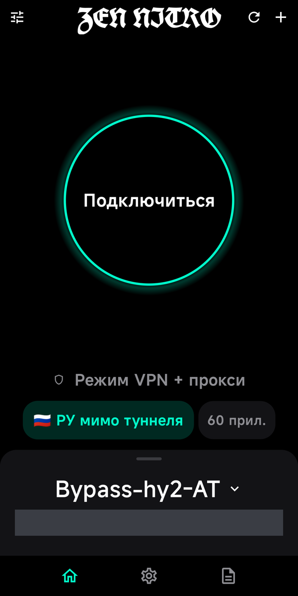 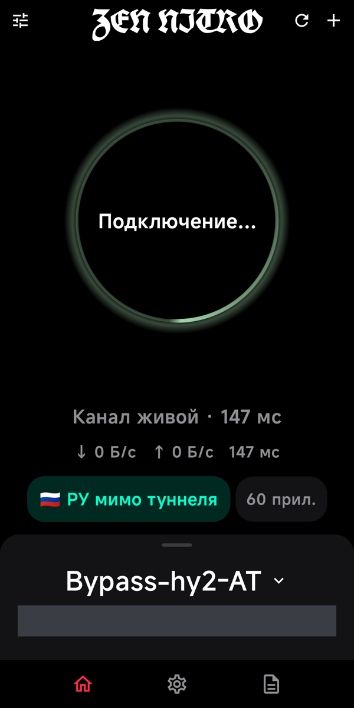 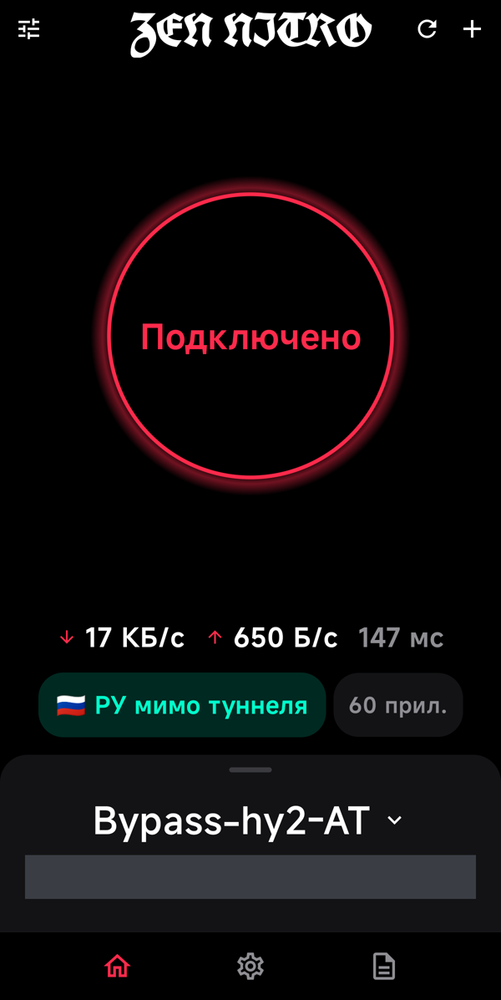

Сверху вниз:

1. **Кольцо** 250 × 250 dp. Тонкая окружность 3 dp радиусом (сторона/2 − 12 dp),
   под ней мягкое свечение (радиальный градиент от 86,5 % до 100 % радиуса,
   прозрачность пульсирует 0,35↔0,75 за 1,4 с). Цвет: accent в покое →
   accent2 при подключении (переход 5 с во время подключения, 0,5 с иначе).
   Во время подключения по окружности бежит яркая дуга (вращение 0,45 с на
   оборот, дуга 3 × 1,4 dp со скруглёнными концами).
   Надпись в центре (ширина ≤ 180 dp):

   | Состояние | Надпись | Цвет надписи |
   |---|---|---|
   | отключено | Подключиться | белый |
   | идёт подключение | Подключение… | белый |
   | подключено | Подключено | accent2 |
   | канал молчит | Связь пропала… | `#E87A3A` |
   | нет сети | Нет сети | `#E87A3A` |
   | переподъём, проверка | Переподключаюсь… | `#E87A3A` |
   | нода не принимает | Нет связи | `#E87A3A` |

   Нажатие: подключить / отключить.
2. **Строка состояния** (отступы по бокам 24 dp):
   - отключено — щит 16 dp gray и режим: «Режим VPN», «Режим VPN + прокси»,
     «Режим прокси», «VPN + DPI-щит», «Режим DPI-щита»;
   - подключается — что делается сейчас («Проверяю канал… (2/3)», «Жду ответа
     сервера…»), под ней мелко ↓ ↑ скорости;
   - подключено — ↓ скорость, ↑ скорость (стрелки 16 dp цветом кольца, числа
     белым 14 sp), пинг «N мс» gray;
   - kill switch держит трафик — щит и «Трафик заблокирован — туннель лежит»
     цветом accent2.
3. **Чипы режима** (скругление 20 dp): «🇷🇺 РУ мимо туннеля» — включает и
   выключает обход российских сайтов и приложений (включён — подложка accent,
   текст accent), рядом «N прил.» — открывает список приложений мимо туннеля.
4. **Нижняя шторка** (карточка `card`, скругление сверху 22 dp, ручка 34 × 4 dp
   `#3A3A3F`): метки ноды (чипы «🤖 AI», «🎬 Видео», «🎮 Игры» — ставит
   человек), имя ноды с ▾, под ним «Протокол | адрес · имя сервера». Нажатие
   по шторке открывает «Серверы». Долгое нажатие по имени — окно меток.

Состояния кольца удобно видеть в работе: подключение — дуга бежит, цвет
плавно краснеет; «Связь пропала…» — оранжевая надпись при живом кольце.

## 6. Окна главной

### 6.1. «Режимы» (кнопка слева в шапке)

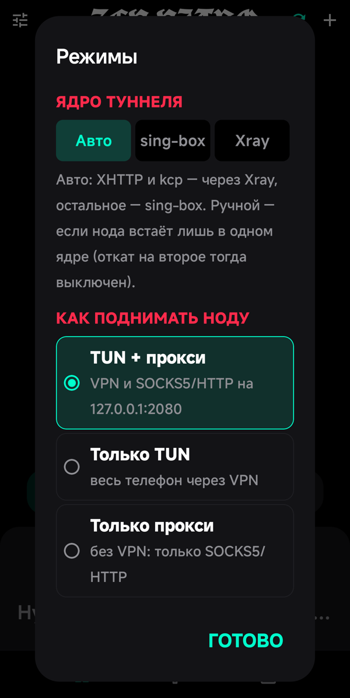

- **ЯДРО ТУННЕЛЯ**: Авто / sing-box / Xray — три кнопки в ряд. Авто выбирает
  по транспорту ноды (XHTTP и kcp — только Xray).
- **КАК ПОДНИМАТЬ НОДУ**: три компактные плитки столбиком с кружком выбора —
  «TUN + прокси», «Только TUN», «Только прокси», под каждой — короткое пояснение.
  Окно прокручивается, если не влезает по высоте.
  Смена при подключении — сразу переподъём.
- Кнопка **ГОТОВО** (accent, 14 sp).

### 6.2. «Надпись сверху» (нажатие на название)

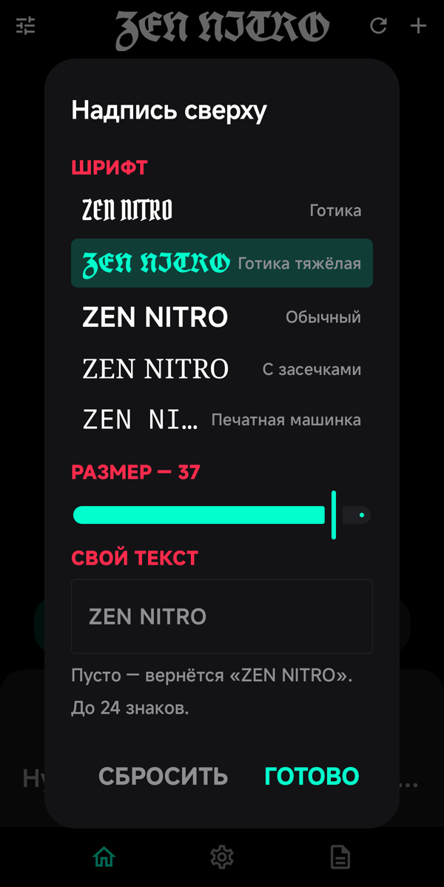

Шрифт — пять образцов строкой «ZEN NITRO» с подписью справа, выбранный на
подложке accent2; **РАЗМЕР** — ползунок 16–40; **СВОЙ ТЕКСТ** — поле (пусто =
«ZEN NITRO», до 24 знаков); кнопки **СБРОСИТЬ** и **ГОТОВО**.

### 6.3. «Серверы» (нажатие по шторке)

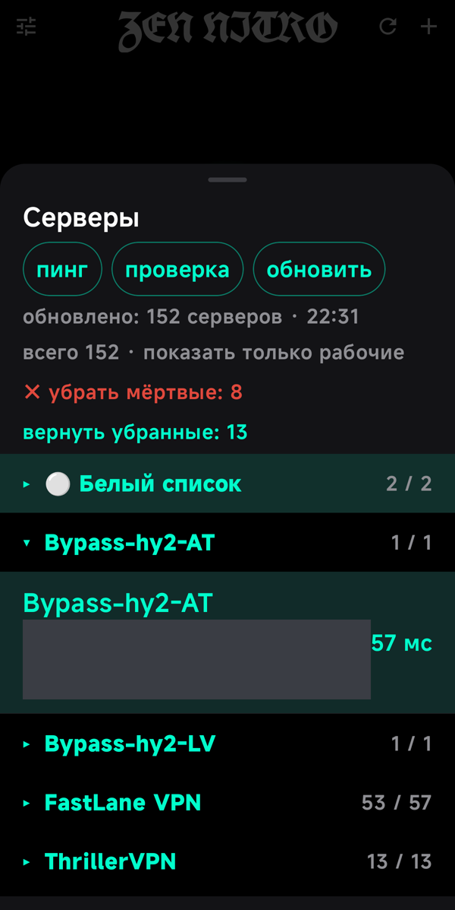 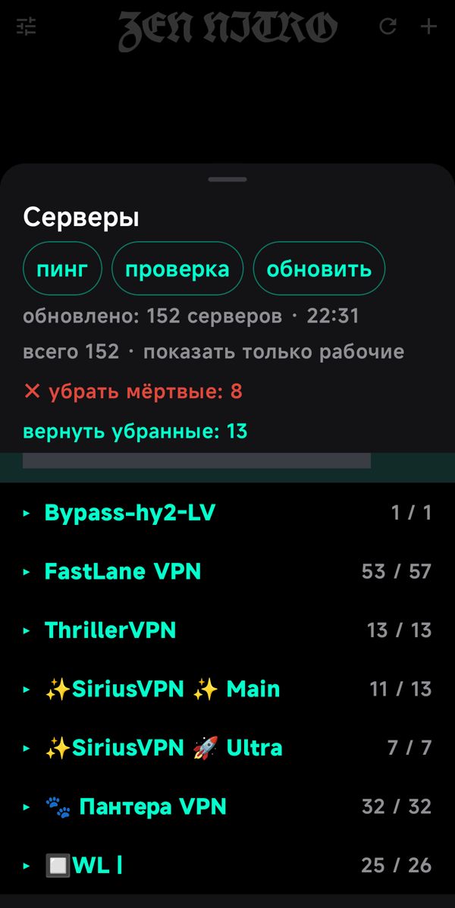

Шторка на 82 % высоты поверх затемнения `#CC000000`, скругление сверху 22 dp,
ручка как у главной.

- Заголовок «Серверы» (17 sp) и чипы **пинг** (перемерить все), **проверка**
  (разбор линии до выбранной по байтам; «проверяю…»), **обновить** (подписки;
  «обновляю…»).
- Строки статуса (12 sp, gray): «обновлено: N серверов · ЧЧ:ММ», «всего N ·
  показать только рабочие» (переключает показ мёртвых), красное «✕ убрать
  мёртвые: N», бирюзовое «вернуть убранные: N».
- **Полки по подпискам**: «▸ / ▾  Имя подписки», справа «живых / всего»;
  у полки с выбранной нодой — «выбран». Полка выбранной ноды открыта, прочие
  закрыты. Над устаревшей полкой — «⚠ … — ноды ниже старые» оранжевым.
- **Нода**: имя (16 sp, до 3 строк), детали 12 sp (протокол, адрес,
  «АВАРИЙНАЯ», «прикрытие возможно»), справа пинг: до 150 мс — accent,
  151–399 — `#E8B23A`, 400–899 — `#E87A3A`, нет ответа — `#E0483C`;
  «~N мс» — оценка, «✓ была» — пинга нет, но туннель через неё поднимался,
  «нет» — молчит несколько замеров, «…» — QUIC ещё не ответил. Выбранная —
  подложкой accent. Справа «✕» — убрать ноду (подложка красная 12 %).
- Нажатие по ноде — выбрать (при поднятом туннеле — переключиться на ходу).
- Группы провайдера («АВТО ВЫБОР», «АВТО ОБХОД (БС)») — одна строка с ⚖:
  поднимается целиком с балансировщиком.

### 6.4. «Мимо туннеля» (чип «N прил.»)

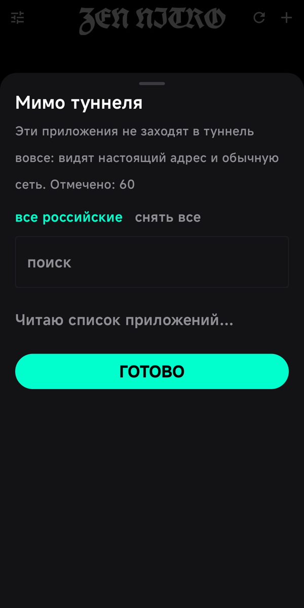

Заголовок, чипы «все российские» и «снять все», поиск, список приложений
(имя, пакет, пометка «российское»), галочка — приложение идёт мимо VPN.

## 7. Настройки

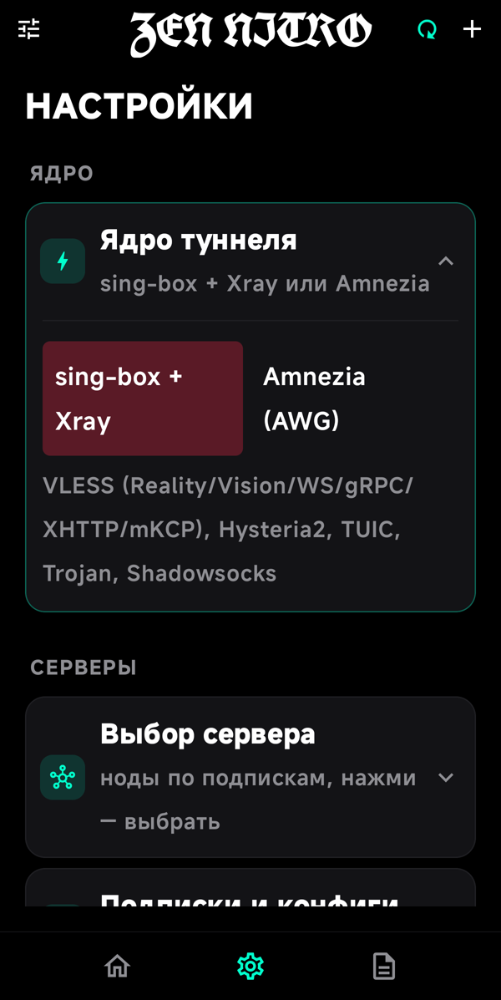

Плитки, сгруппированные подписями. Плитка: карточка `card`, скругление 16 dp,
рамка 1 dp `divider` (у раскрытой — accent при 35 %), отступ снизу 8 dp.
Шапка плитки: квадрат 36 dp со скруглением 10 dp и подложкой accent 14 %,
в нём значок 20 dp цветом accent; заголовок 15 sp полужирный и подпись 12 sp;
справа стрелка ▾ (поворачивается на 180° у раскрытой). Нажатие по шапке —
раскрыть / свернуть, содержимое под линией `divider` с отступами 14 dp.
Что раскрыто — помнится, пока приложение открыто.

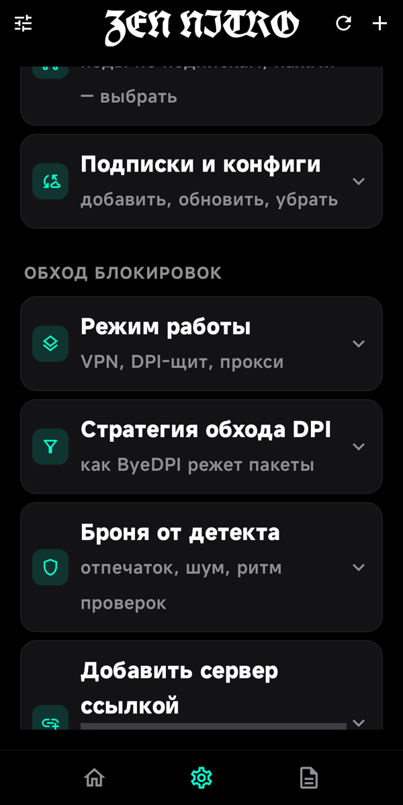 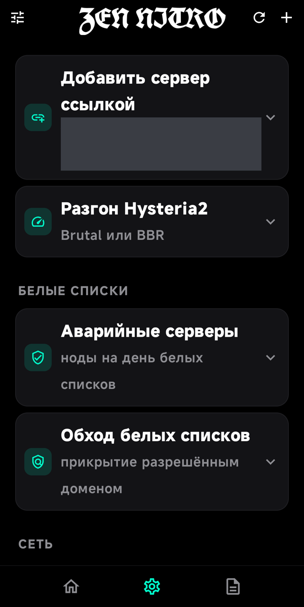 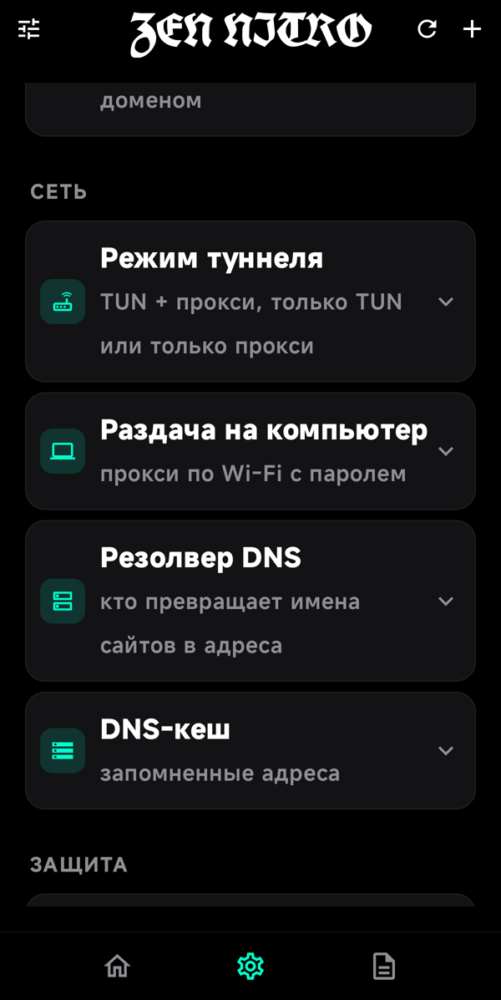 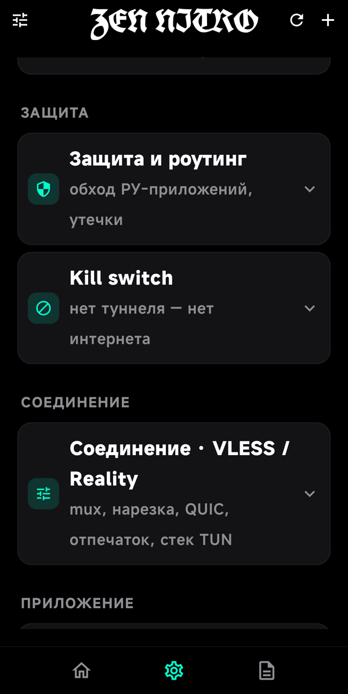

Порядок и содержимое (значок — из Material Icons, Outlined):

| Группа | Плитка (значок) | Что внутри |
|---|---|---|
| ЯДРО | **Ядро туннеля** (Bolt), раскрыта сразу | Две кнопки: «sing-box + Xray» / «Amnezia (AWG)», под ними список протоколов. Смена при подключении — переподъём |
| СЕРВЕРЫ | **Выбор сервера** (Hub) | Те же полки и ноды, что в шторке «Серверы»; кнопка **ОБНОВИТЬ И ЗАГРУЗИТЬ СЕРВЕРЫ** |
| | **Подписки и конфиги** (CloudSync) | Список подписок (имя, ссылка, удалить), поле «https://… или vless:// hysteria2:// trojan:// ss:// tuic://», **ДОБАВИТЬ**, **ИЗ БУФЕРА** |
| ОБХОД БЛОКИРОВОК | **Режим работы** (Layers) | Переключатели «VPN (сервер из списка, меняет IP)» и «DPI-щит ByeDPI (обход без VPN)» |
| | **Стратегия обхода DPI** (FilterAlt) | Выбор стратегии ByeDPI: Бронебойная (авто), Классическая (split SNI), Агрессивная (fake+split), Мульти-сплит, Мягкая (split method), Максимальная (fake TTL); пускать VPN через щит |
| | **Броня от детекта** (Shield) | «Маскировка туннеля под обычный HTTPS» + пояснение, что делает броня |
| | **Добавить сервер ссылкой** (AddLink) | Поле «vless://… hysteria2://… ss://…», **ДОБАВИТЬ**, **ИЗ БУФЕРА** |
| | **Разгон Hysteria2** (Speed) | «Держать темп (режим Brutal)», поля «приём, Мбит/с» и «отдача, Мбит/с» |
| БЕЛЫЕ СПИСКИ | **Аварийные серверы** (VerifiedUser) | Список аварийных нод (статус прикрытия цветом), поле ссылки, **В АВАРИЙНЫЕ**, **ИЗ БУФЕРА** |
| | **Обход белых списков** (Policy) | «Прикрываться разрешённым доменом», поле домена (www.gosuslugi.ru), быстрые варианты («CDN VK» и др.) |
| СЕТЬ | **Режим туннеля** (Router) | Три плитки с кружком: TUN + прокси / Только TUN / Только прокси. Для двух прокси-режимов — блок «ЛОКАЛЬНЫЙ ПРОКСИ · SOCKS5 + HTTP»: Адрес 127.0.0.1, Порт 2080, «SOCKS5 авторизация», Логин, Пароль (точками, «глаз» — показать), у каждой строки кнопка копирования; «↻ Сбросить логин и пароль»; пояснение |
| | **Раздача на компьютер** (Computer) | «Пускать в прокси из локальной сети», адрес телефона в Wi-Fi, порт, логин и пароль для ПК |
| | **Резолвер DNS** (Dns) | Список резолверов (Cloudflare, Google, Яндекс, AdGuard, Quad9, DNS.SB, ControlD, Switch, свой) с пометками, поле «https://адрес/dns-query», **ПРОВЕРИТЬ ВСЕ РЕЗОЛВЕРЫ** |
| | **DNS-кеш** (Storage) | Что в кеше, «Авто-сброс при смене сети», сбросить |
| ЗАЩИТА | **Защита и роутинг** (Security) | **ПРОВЕРИТЬ УТЕЧКИ**, «РУ-сайты и приложения мимо туннеля», список приложений |
| | **Kill switch** (Block) | «Рвать трафик, если туннель упал», **ОТКРЫТЬ СИСТЕМНЫЕ НАСТРОЙКИ VPN**, «Только IPv4 → IPv6», «Авто-реконнект при обрыве», «Сам переходить на другую ноду, если выбранная не встаёт», «Держать телефон бодрствующим, пока работает туннель (нужно на Xiaomi/HyperOS)» |
| СОЕДИНЕНИЕ | **Соединение · VLESS / Reality** (Tune) | Mux, Нарезка TLS-приветствия, Блокировать QUIC на TCP-нодах; Отпечаток TLS: Chrome 120 (лёгкий) / iOS / Chrome (тяжёлый) / Firefox; Стек TUN: авто / gvisor / system / mixed |
| ПРИЛОЖЕНИЕ | **Внешний вид** (Palette) | Темы плитками по две в ряд (имя, пара слов, три кружка: фон, accent, accent2; выбранная — рамкой accent 2 dp и ✓); **НАСТРОИТЬ НАДПИСЬ** |
| | **Обновления** (SystemUpdate) | Что стоит, поле адреса update.json, **ПРОВЕРИТЬ СЕЙЧАС**, кнопка обновления, если есть новое |
| | **Ядра** (Memory) | Версии встроенных и модулей (Xray, Amnezia, AWG 1.x, sing-box), **ПРОВЕРИТЬ ОБНОВЛЕНИЯ ЯДЕР**, **ПОСТАВИТЬ …**, **ВЕРНУТЬ ВСТРОЕННОЕ: …**, второй источник модулей |

Снимки каждой раскрытой плитки (два кадра: начало и продолжение):

| Плитка | Снимки |
|---|---|
| Выбор сервера | [1](ui/12-выбор-сервера-1.png) · [2](ui/12-выбор-сервера-2.png) |
| Подписки и конфиги | [1](ui/13-подписки-и-конфиги-1.png) · [2](ui/13-подписки-и-конфиги-2.png) |
| Режим работы | [1](ui/14-режим-работы-1.png) · [2](ui/14-режим-работы-2.png) |
| Стратегия обхода DPI | [1](ui/15-стратегия-dpi-1.png) · [2](ui/15-стратегия-dpi-2.png) |
| Броня от детекта | [1](ui/16-броня-1.png) · [2](ui/16-броня-2.png) |
| Добавить сервер ссылкой | [1](ui/17-добавить-ссылкой-1.png) · [2](ui/17-добавить-ссылкой-2.png) |
| Разгон Hysteria2 | [1](ui/18-разгон-hysteria2-1.png) · [2](ui/18-разгон-hysteria2-2.png) |
| Аварийные серверы | [1](ui/19-аварийные-серверы-1.png) · [2](ui/19-аварийные-серверы-2.png) |
| Обход белых списков | [1](ui/20-обход-белых-списков-1.png) · [2](ui/20-обход-белых-списков-2.png) |
| Режим туннеля | [1](ui/21-режим-туннеля-1.png) · [2](ui/21-режим-туннеля-2.png) |
| Раздача на компьютер | [1](ui/22-раздача-на-компьютер-1.png) · [2](ui/22-раздача-на-компьютер-2.png) |
| Резолвер DNS | [1](ui/23-резолвер-dns-1.png) · [2](ui/23-резолвер-dns-2.png) |
| DNS-кеш | [1](ui/24-dns-кеш-1.png) · [2](ui/24-dns-кеш-2.png) |
| Защита и роутинг | [1](ui/25-защита-и-роутинг-1.png) · [2](ui/25-защита-и-роутинг-2.png) |
| Kill switch | [1](ui/26-kill-switch-1.png) · [2](ui/26-kill-switch-2.png) |
| Соединение · VLESS / Reality | [1](ui/27-соединение-vless-reality-1.png) · [2](ui/27-соединение-vless-reality-2.png) |
| Внешний вид | [1](ui/28-внешний-вид-1.png) · [2](ui/28-внешний-вид-2.png) |
| Обновления | [1](ui/29-обновления-1.png) · [2](ui/29-обновления-2.png) |
| Ядра | [1](ui/30-ядра-1.png) · [2](ui/30-ядра-2.png) |

## 8. Журнал и терминал (третья вкладка)

Сверху переключатель на два сегмента «📜 Журнал» / «⌨️ Терминал»
(подложка `card`, скругление 14 dp, рамка `divider`; выбранный сегмент —
подложка accent 18 %, текст accent жирный).

### 8.1. Журнал

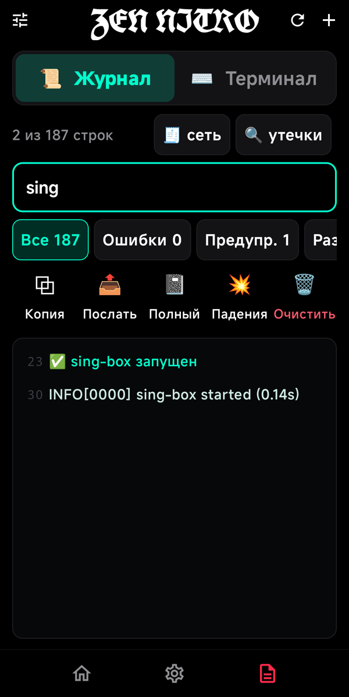

- «N из M строк» gray 11 sp, справа чипы **🧾 сеть** (опрос сети: белые
  списки или нет) и **🔍 утечки** (окно проверки утечек).
- Поле поиска «🔎 Текст, IP или домен» (скругление 12 dp, рамка accent в фокусе).
- Чипы-фильтры со счётчиками: Все, Ошибки, Предупр., Разбор, Ядро, События
  (скругление 10 dp, выбранный — рамка и текст accent, подложка accent 18 %).
- Кнопки: ⧉ **Копия** (видимые строки в буфер), 📤 **Послать** (файл
  журнала через «Поделиться»), 📓 **Полный** (журнал за всё время в окне),
  💥 **Падения** (журнал вылетов), 🗑 **Очистить** (красным).
- Окно строк: фон `#07080A`, скругление 12 dp, рамка `divider`; строки 11 sp
  с номером слева, цвет по виду строки (см. 2.2), дамп байтов — моноширинным.
  Текст можно выделять. Новые строки — автопрокрутка вниз.

### 8.2. Терминал

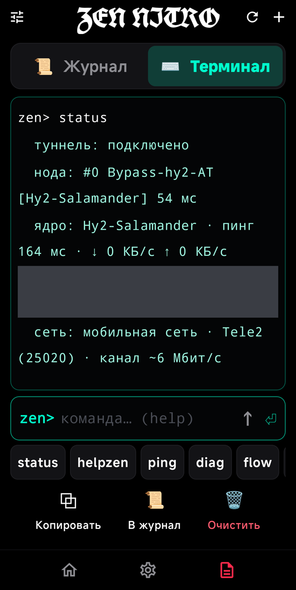 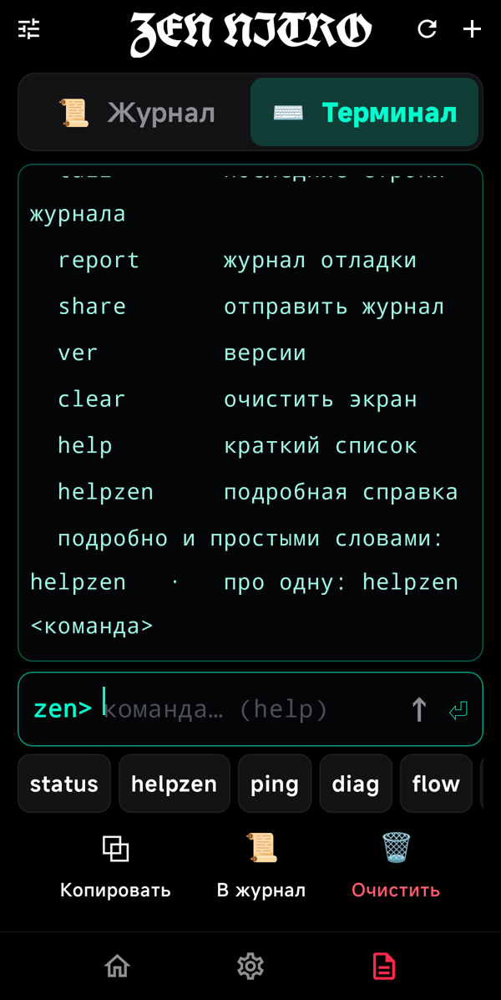

- Экран вывода: фон `#040506`, рамка accent 35 %, моноширинный 12 sp.
- Строка ввода: «zen>» accent жирный, поле, «↑» — прошлые команды по кругу,
  «⏎» — выполнить (или «Отправить» на клавиатуре).
- Быстрые команды чипами: status, helpzen, ping, diag, flow, net, wl, proxy, get, tail.
- Кнопки: ⧉ Копировать, 📜 В журнал, 🗑 Очистить.

| Команда | Что делает |
|---|---|
| `status` | состояние туннеля, нода, ядро, пинг, скорость, выход, сеть |
| `connect` · `disconnect` · `reconnect` | подключить / отключить / переподнять |
| `nodes [текст]` · `wl` · `use #N\|имя` | список нод, ноды для белых списков, выбрать ноду |
| `ping` · `diag` · `flow` · `net` · `dns` · `leaks` | перемерить, разбор линии, немые соединения, опрос сети, DNS, утечки |
| `subs` · `cores` | обновить подписки, проверить ядра |
| `proxy [show]` · `themes` · `get` | локальный прокси, список тем, текущие настройки |
| `set mux\|frag\|quic\|autoswitch\|killswitch\|armor\|auth on\|off` | переключатели |
| `set fp …` · `set stack …` · `set mode tun\|tun+proxy\|proxy` · `set theme …` | выборы |
| `tail [N]` · `report` · `share` · `ver` · `clear` | хвост журнала, отчёт, отправить, версии, очистить |
| `help` · `helpzen [команда]` | кратко / подробно простыми словами |

## 9. Вне приложения

- **Уведомление** работающего туннеля: заголовок — имя ноды, подзаголовок —
  состояние и скорость; кнопки **Отключить** и **Метка** (пометить момент в
  журнале — ищется по ★★★).
- **Плитка в шторке Android**: подключить / отключить без открытия приложения,
  подпись — нода. На Windows аналог — значок в трее с тем же меню.
- **Значок приложения**: разбитое кольцо (бирюзовая дуга, отколотый алый
  сегмент) на графитовом квадрате.

## 10. Компоненты для переноса

| Компонент | Размеры и поведение |
|---|---|
| Плитка `SetCard` | см. раздел 7 |
| Подпись группы `SetGroup` | 11 sp, жирный, разрядка 1 sp, gray; отступ сверху 18 dp, снизу 6 dp, слева 4 dp |
| Переключатель `ToggleRow` | строка по всей ширине (нажатие по строке тоже переключает), отступ по вертикали 6 dp; название и, если подпись была «Название — пояснение», пояснение под ним; Switch: вкл. — дорожка accent, бегунок чёрный; выкл. — дорожка `#1C1D22`, бегунок gray, рамка divider |
| Выбор `ChoiceRow` | название 14 sp, под ним чипы всех вариантов в ряд (прокрутка по горизонтали), чип: скругление 10 dp, отступы 12 × 8 dp, выбранный — accent 18 % и рамка accent |
| Плитка-вариант `ModeOption` | скругление 12 dp, рамка 1 dp (accent у выбранной, иначе divider), кружок 18 dp с рамкой 2 dp и точкой 9 dp у выбранной, название 14 sp полужирное и пояснение 12 sp |
| Строка с копированием `CopyRow` | подпись 72 dp gray 13 sp, значение mono 14 sp, «глаз» и «копировать» по 34 dp |
| Плитка темы | половина ширины, скругление 14 dp, фон — `card` самой темы, рамка — её divider (у выбранной accent 2 dp), имя 14 sp, описание 11 sp в 2 строки, три кружка 16 dp |
| Чип журнала `LogChip` | скругление 10 dp, отступы 10 × 6 dp, 12 sp |
| Кнопка журнала `LogAction` | значок-эмодзи 16 sp над подписью 10 sp, равная ширина |
